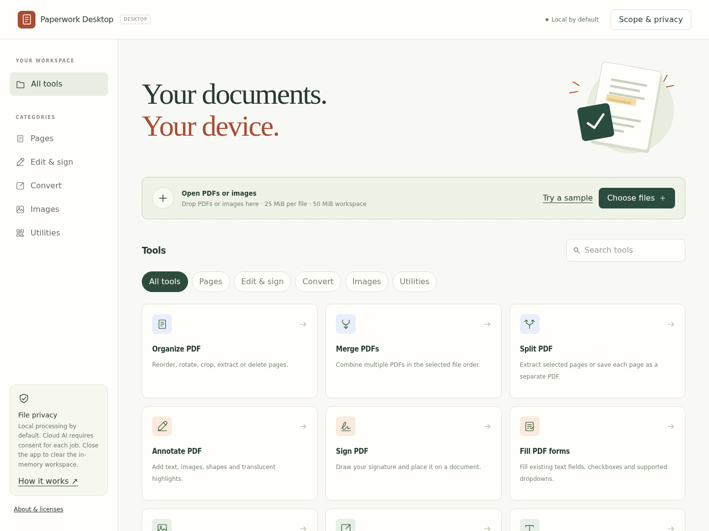
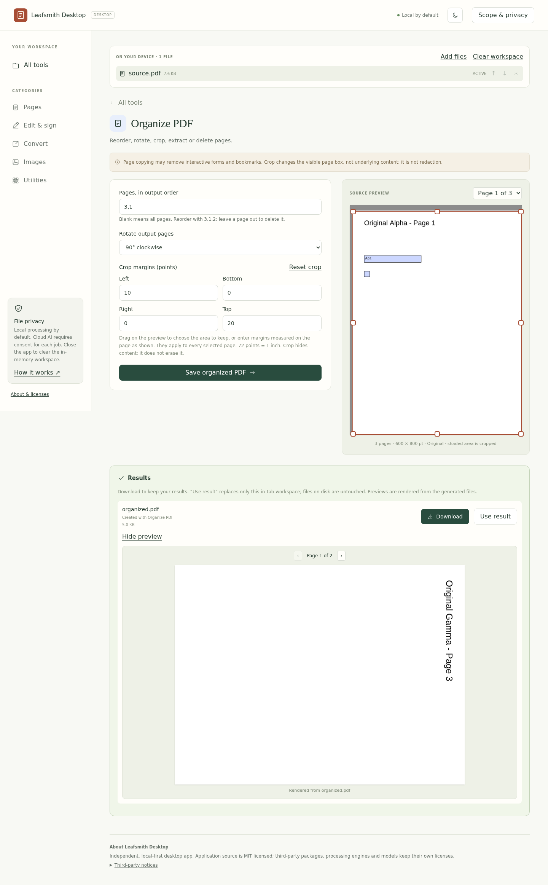

# Paperwork

Local-first PDF, document, image and media tools for [your browser](https://paperwork.lakebed.app) and desktop.

The [browser edition](web/README.md) runs in your browser with a reduced feature set. The desktop edition adds native document and media tools. Both editions are maintained together; the existing GitHub URL and published downloads remain unchanged.

## Desktop edition

**Release status:** [0.1.0 RC2](https://github.com/ClawPick2026/paperwork-desktop/releases/tag/v0.1.0-rc.2) publishes a Windows x86_64 installer and a Linux x86_64 AppImage. On both platforms the packaged app passed native host/worker checks and 22 packaged document-operation checks, after silent installation on Windows and AppImage extraction under Xvfb on Ubuntu 22.04. Both packages are unsigned. Interactive use, other Linux distributions and the optional engine/model packs have not been tested with this release. This is not the finished release.

## Main Window

The desktop interface captured during real-browser verification. This image does not establish packaged-app or installer compatibility.

## What you can do

The built-in workspace provides:

- Merge, split, reorder, rotate, crop, extract and delete PDF pages.
- Add text, images, shapes and flattened highlights; draw electronic signatures.
- Fill supported PDF forms and extract embedded text.
- Convert images to PDF and PDF pages, or cropped areas of them, to images.
- Crop, resize, combine and compress images, and generate QR codes.
- Drag on the page or image preview to set crop areas and annotation or signature boxes. Results shows a preview rendered from each generated PDF, image or text file.

The separate **Native tools** workspace adds existing-text editing and standard-font replacement, genuine PDF comments/highlights, Office export/import, OCR, form templates, password protection and known-password unlocking, selected text-watermark removal, PDF/image/video processing, transcription, summaries and text translation. Some operations require a separately installed processing engine or AI model. Native platform and real-engine validation is still in progress; see the release status above.

## Common feature previews

### Organize PDF pages

Select pages and export a new document without overwriting the input.

### Native document tools

Native files are selected separately from the built-in workspace. Required engines must be available before a job can run.

## First use

Download the [Windows preview installer](https://github.com/ClawPick2026/paperwork-desktop/releases/download/v0.1.0-rc.2/Paperwork_0.1.0_x64-setup.exe) or the [Linux AppImage](https://github.com/ClawPick2026/paperwork-desktop/releases/download/v0.1.0-rc.2/Paperwork_0.1.0_amd64.AppImage). Read the [release notes, SHA-256 checksums and precise test scope](https://github.com/ClawPick2026/paperwork-desktop/releases/tag/v0.1.0-rc.2) first: Windows may show an unrecognized-publisher warning, and the AppImage needs glibc 2.35 or later and must be made executable (`chmod +x`) before running. Use copies of non-sensitive documents during preview testing. The [browser edition](https://paperwork.lakebed.app) remains available with its explicitly reduced feature set.

For the built-in workspace, choose **Try a sample**, open **Organize PDF**, select an operation and download the resulting document. For your own work, use **Choose files** and retain the originals.

In **Native tools**, choose a task, select native input files, enter its parameters and run it. Use **Save output** to retain each result outside the private job cache. Optional engines and models are managed under **Optional components & models**, with separate download consent. A missing or unpublished component is not assumed installed.

For local AI, use an explicitly selected local model file, an available downloaded model, or a running local Ollama service with an installed model. Cloud processing is optional: supply your own provider settings and API key, then approve that individual job. Keys are not saved in application settings.

## Scope and limitations

- Existing-text editing changes selected text objects; it is not a general layout editor. Complex scripts, nested text, original font embedding and non-Latin text replacement are not supported by the current editor.
- PDF-to-Office export reconstructs content approximately. Fonts, tables, reading order, images and layout can differ.
- OCR adds searchable text and editable text/document exports; it does not turn the original scanned pixels into a fully editable layout.
- Drawn signatures are electronic images, not certificate-backed digital signatures.
- Unlocking requires a password you already know. Watermark removal is targeted, not automatic removal from arbitrary images or page content.
- Lossless PDF optimization may not reduce size. Raster compression is lossy and flattens text, forms, links and annotations.
- AI output can omit, invent or mistranslate information. Translation creates a newly typeset text document, not a layout-preserving copy. Language/font coverage and model quality vary.

## Safety and privacy

- Local processing is the default. No document content is automatically uploaded for cloud AI; cloud jobs require individual approval.
- Optional component/model downloads contact their distribution servers and require consent. Their licenses are displayed separately.
- Native processing writes private temporary files and outputs to the app cache. Successful outputs remain available to save during the session. Normal exit and startup attempt to clean job caches; a crash, forced termination or cleanup failure can leave files on disk. This is ordinary deletion, not secure erasure.
- Closing the app clears the in-memory workspace. Save desired outputs first; keep separate backups of original documents.
- Processing untrusted files is not an operating-system sandbox. Review sensitive or adversarial documents accordingly.

## Compatibility

The first release targets **Windows x86_64** and **Linux x86_64**. ARM64 and macOS packages are not currently provided. Linux compatibility depends on the packaged libraries and host desktop requirements; no universal distribution compatibility is claimed. Packages are unsigned unless a release explicitly says otherwise, and Windows may display a SmartScreen warning.

## License and support

Paperwork's application code is [MIT licensed](LICENSE). Libraries, processing engines, fonts and AI models retain their own licenses; the application license does not relicense those components.

Report reproducible problems through [GitHub Issues](https://github.com/ClawPick2026/paperwork-desktop/issues). Do not attach private documents, passwords or API keys.
