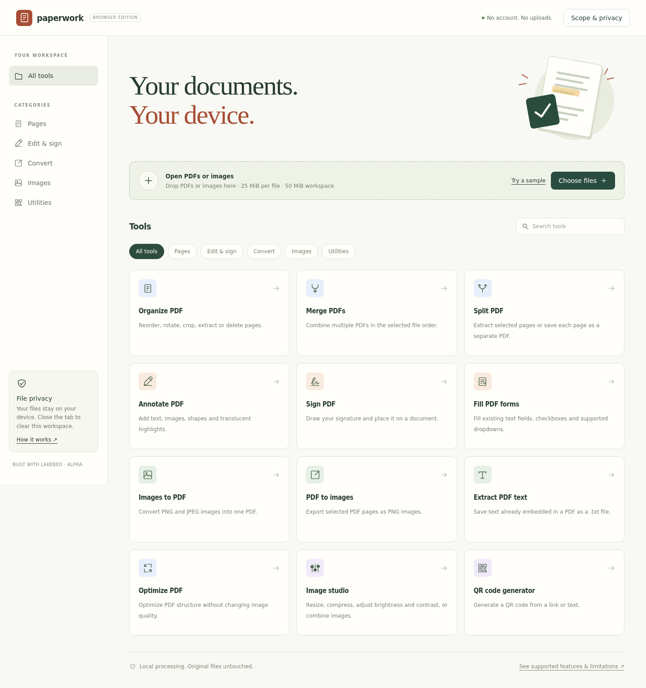
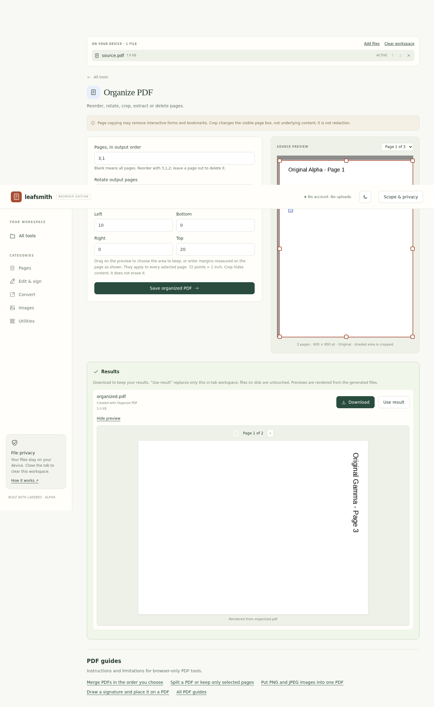

# Paperwork — browser edition

The browser edition and [desktop app](../README.md) are maintained together in one Paperwork repository. Their feature sets and privacy boundaries remain distinct.

Sort, annotate, sign and transform documents without uploading them from your browser.

**Status: working preview, not a production or security-audited PDF service.** This is the reduced browser-only edition selected for the project. It does not implement the full original feature wishlist. Lakebed itself is a public alpha.

[Open Paperwork](https://paperwork.lakebed.app). The deployment is claimed and has no automatic expiry. The original preview URL also remains available.

## Main Window

## What you can do

- **Manage pages:** merge, split, reorder, rotate, crop, extract and omit pages.
- **Annotate:** add new text in three standard fonts, PNG/JPEG images, rectangle outlines and flattened translucent highlights.
- **Sign:** draw and place an electronic signature. It is added as a locked stamp annotation, so it appears above page content, form fields and earlier annotations. This is not certificate-backed digital signing or identity verification.
- **Fill forms:** existing AcroForm text fields, checkboxes and single-choice dropdown/option-list fields; optional flattening.
- **Convert:** PNG/JPEG images to PDF, selected PDF pages (or a cropped area of them) to PNG, and existing embedded PDF text to a plain-text file.
- **Optimize:** try structural PDF optimization without downsampling images. The original bytes are returned if the result would be larger; savings are not guaranteed.
- **Work with images:** crop, resize, export JPEG/PNG/WebP, adjust brightness and contrast, or combine images vertically/horizontally. This is not AI enhancement.
- **Generate QR codes:** locally generated, downloadable SVGs for links or text.

## First use

1. Open the running Paperwork website in a JavaScript-enabled browser.
2. Select **Choose files**, or use **Try a sample** in an empty workspace.
3. Choose a tool. The highlighted **ACTIVE** file is used for single-file tools; file order determines merge and image order.
4. Adjust the settings and run the operation.
5. Download each result. **Use result** replaces the in-tab workspace with that PDF to continue editing; files on disk are never overwritten.

The source preview shows the **original document**. For crop, annotation and signature tools it also marks the area or box you set; drag on the preview to change it. Other pending edits are not drawn on the source preview. After a run, **Results** shows a preview rendered from each generated PDF, image or text file.

## Page workflows

- **Reorder and extract:** enter `3,1` to produce page 3 followed by page 1. Omitted pages are deleted from the output; blank means all pages.
- **Rotate and crop:** rotate output pages and trim visible margins by dragging on the preview or entering margins in PDF points, measured on the page as displayed. Cropping is not redaction: hidden content remains in the PDF.

## Not included

- Changing original PDF text/fonts or reflowing existing text.
- Word, Excel, PowerPoint or other Office-format conversion.
- OCR, searchable scanned PDFs or extracting text from images.
- Encryption, password unlocking, watermark removal or secure redaction.
- AI summaries, book summaries or translation.
- Audio/video transcription or video compression.
- Form template library, creating new form fields, XFA, radio-button editing, multi-select form editing or certificate signatures.
- Editable PDF comment objects: notes and highlights here are flattened page content.

Unsupported operations are documented rather than represented by non-working buttons. Password-protected PDFs are rejected, even when you know the password.

## Privacy and safe handling

Files and generated results remain in this tab's memory. Paperwork does not upload them to Lakebed or an AI provider, and does not save them between page loads. Download everything you want to keep **before refreshing, closing the tab or clearing the workspace**. A successful new run replaces the previous set of results; a failed run preserves previous downloads.

The website and its version-pinned processing libraries require an internet connection. Hosting/CDN services receive ordinary network metadata such as IP addresses. Third-party scripts execute in the page; this preview is not suitable for highly sensitive material without an independent security review.

Page-copy operations can lose interactive form fields, bookmarks and other document structure. Any PDF rewrite can invalidate existing certificate signatures. Save an original copy and visually inspect important outputs in your usual PDF viewer.

Standard overlay/form fonts support Western Latin characters, not all Unicode scripts. PDF text extraction can lose reading order and layout. Complex PDFs may render differently, fail, or lose unsupported features.

## Limits

- Up to 8 workspace files.
- 25 MiB per input file; 50 MiB combined.
- 1–200 pages per PDF, including merged output.
- Up to 30 individual page downloads per split/image-export run.
- Canvas operations: 16 million pixels. Image adjustment output is additionally capped at 4096 pixels per side.
- QR payload: 1000 UTF-8 bytes.

Outputs larger than the input-file limit can be downloaded, but cannot be reopened with **Use result**. Memory consumption is device-dependent; being under these limits does not guarantee that a large document will fit in memory.

## Troubleshooting

- **Processing library cannot load:** check your connection and whether `cdn.jsdelivr.net` is blocked. Reopen the file to retry reading it.
- **A PDF tool is disabled:** select an unencrypted PDF as the active file. Read errors remain visible after choosing a tool.
- **No fillable form fields:** the document may be a flat scan, use XFA, or contain unsupported widgets. The sample contains a text field and checkbox.
- **Output did not shrink:** the PDF may already be structurally optimized. Image-heavy PDFs normally need downsampling, which this release does not perform.
- **No extractable text:** scanned pages need OCR, which is not included. Text exports label pages with no text accordingly.
- **Text or shapes are in the wrong place:** positions use PDF points from the unrotated page's bottom-left, not screen pixels.

Browser verification has been performed in headless Chromium on Linux ARM64. Compatibility with Safari, Firefox and Sailfish Browser has not been established.
